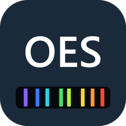
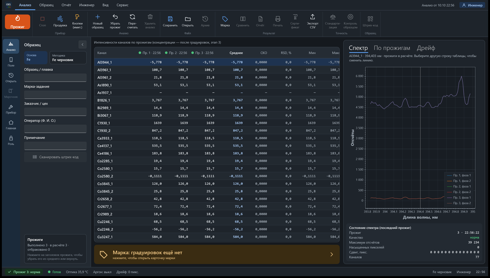
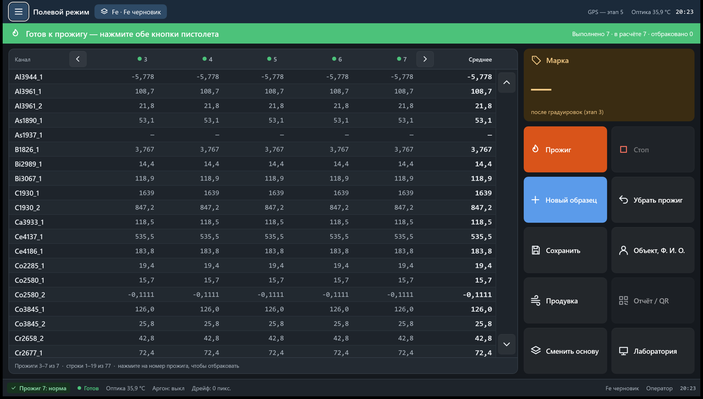
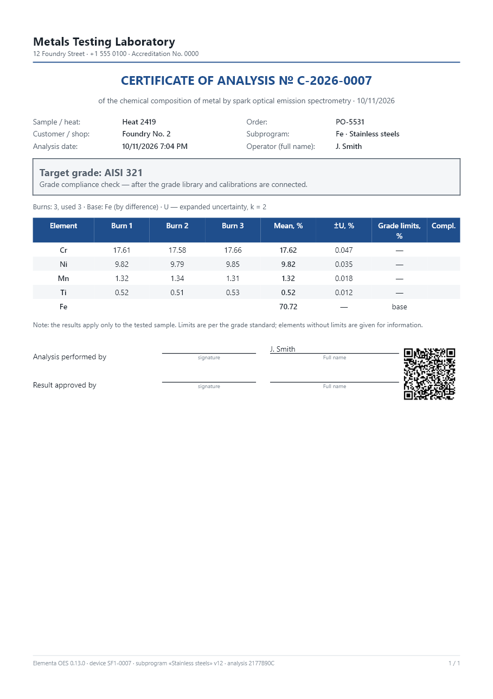
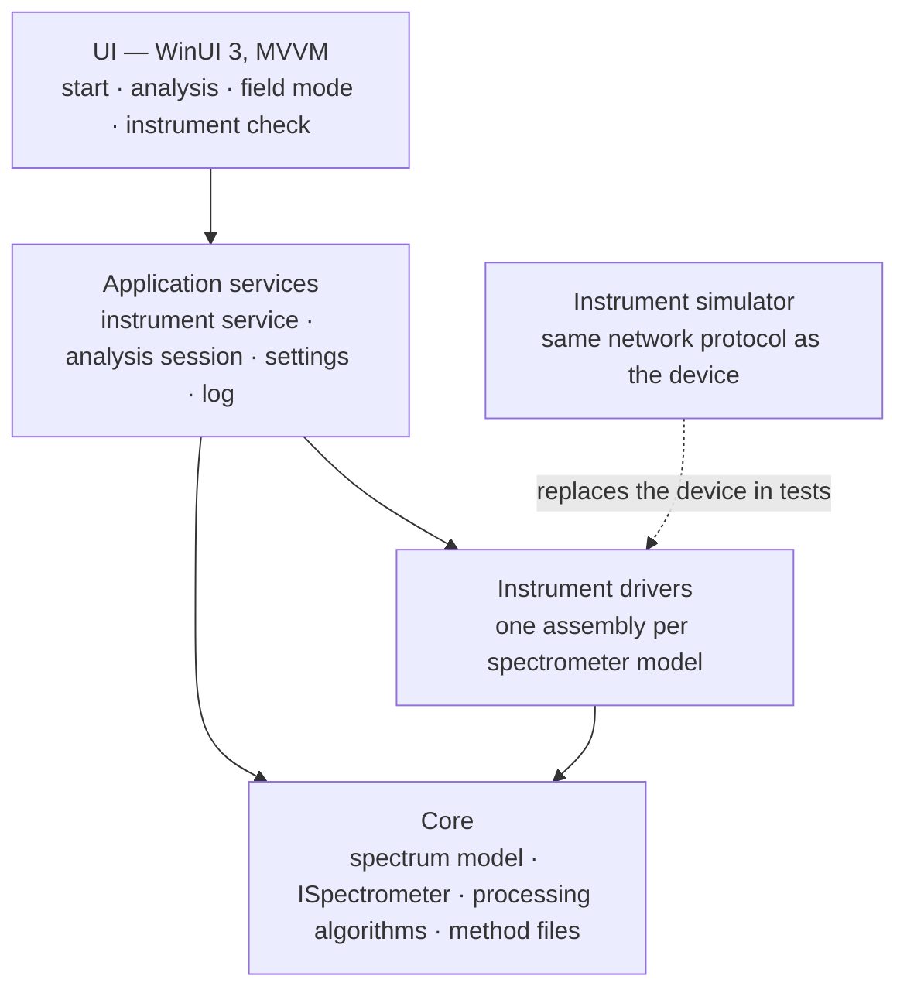
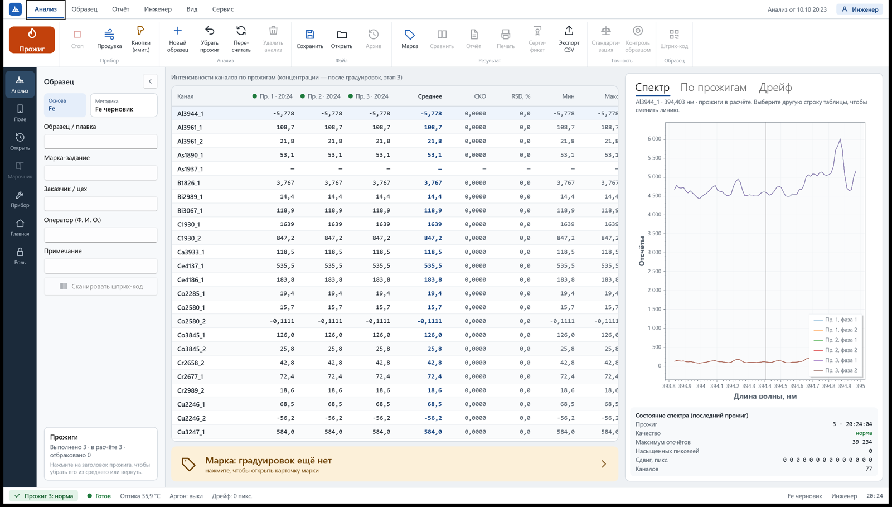

<h1 align="center">Elementa OES</h1>

<b>Software for spark optical emission spectrometers</b> 
burn control · spectrum processing · element concentrations · alloy grade

C# · .NET 8 · WinUI 3 · MVVM · ScottPlot · xUnit &nbsp;|&nbsp; version 0.19.0 (prototype)

> This is a public showcase. The source code is kept in a private repository.
> *Это открытая витрина проекта; исходный код хранится в закрытом репозитории. Описание на русском — ниже.*

## What it does

Elementa OES drives a spark optical emission spectrometer (OES) and turns its raw CCD spectrum into a chemical analysis of a metal sample.

- **Instrument control.** Network connection, spark burn started only when both buttons of the handheld probe are pressed, argon purge, automatic reconnect.
- **Instrument simulator.** A built-in simulator replays recorded spectra, so the whole program can be developed and tested without hardware.
- **Spectrum processing.** Background subtraction, line intensities, peak search, wavelength calibration on reference lines, spectral drift tracking and correction.
- **Calibration.** Curves of several types (linear, through zero, quadratic, square root, log-log), built from certified reference materials. Concentrations relative to the alloy base, valid ranges, recalibration (drift correction by reference samples).
- **Reference materials database.** Groups → sets → samples with certified values, uncertainties, certificate and expiry date; CSV import/export for Excel.
- **Sample analysis.** Several burns per sample with mean, SD, RSD, min and max. Faulty burns are rejected automatically (no spark, saturation, large drift); the operator can also reject any burn by hand.
- **Data protection.** Encrypted per-instrument databases (SQLCipher, keys protected by Windows DPAPI) and password-protected backups; several instruments in one installation.
- **Alloy base detection.** The base is recognised from matrix lines of the spark spectrum after every burn (1091/1091 test spectra correct); wrong subprogram → warning and suggested switch.
- **Roles and passwords.** Operator / engineer / master; the master password is set and recovered with a signed challenge–response code (ECDSA) from a separate native-code generator.
- **Template editor.** WYSIWYG page preview split into A4 pages: drag-and-drop block and field order, per-element fonts and alignment, logo size, page colour, text or image watermark, shapes (lines, rectangles, ellipses, 8-direction arrows, semi-transparent callouts) that are dragged with the mouse, undo/redo. Printing through the standard Windows print dialog.
- **Analysis report and certificate of conformity.** Two documents with their own templates: a detailed lab report and a customer certificate that confirms (or rejects) the declared alloy grade, with grade limits, out-of-limit marks (↑ red / ↓ blue, readable on b/w printers), excluded burns struck through, certificate numbering on issue, lab header with logo, QR code and Code 128 sample barcode. Composition table horizontal (element columns) or vertical. Results export to CSV, Excel and TXT.
- **Certificate of analysis (0.13).** A4 certificate with the lab header and logo, analysis fields, per-burn values, mean and expanded uncertainty (±U, k = 2; SD and RSD optional), signatures and a QR code. PDF, HTML, TXT, CSV and Excel export, printing; reusable report templates (`.eltmpl`).
- **Custom analysis fields.** Text, list, number, date and auto-numbered fields (certificate numbers restart every year); required fields and a 🔒 “remember” lock that carries a value over to the next sample.
- **Activity log.** Tamper-evident audit trail (SHA-256 hash chain) of sign-ins, program and calibration changes, backups and analyses.
- **Installer.** Inno Setup package with a USB-stick workflow: the instrument backup next to the installer is picked up at first start.
- **Languages.** UTF-8 language table (Excel-friendly), 14 interface languages (Russian, English, Italian, Spanish, Portuguese, French, German, Chinese, Japanese, Korean, Polish, Uzbek, Kazakh), program names included, switched instantly; labels adapt to button size.
- **Programs and subprograms.** Methods live in the database with version history: pick an alloy base, then a subprogram (e.g. stainless steels), then lab or field mode.
- **Lab mode and field mode.** Lab mode is a dense ribbon UI for mouse and keyboard. Field mode has large controls for a tablet used with gloves.
- **Roles and themes.** Operator, engineer and master roles; the engineer sees spectra, per-burn plots and drift. Light, dark and system themes.
- **Data.** Everything in the program's own folder: an SQLite database with analyses and every burn spectrum, plus methods and reference materials. One-file backup and restore for moving to another computer; CSV export.

## Architecture

Dependencies point only downwards: the core knows nothing about the UI or the drivers. New spectrometer models are added as separate driver assemblies.

**Testing.** 133 automated tests (xUnit):
- protocol frames and checksums are checked against recorded network traffic;
- the driver is tested end to end against the simulator;
- every ported processing and calibration algorithm is checked number for number against the reference implementation on real methods: line intensities, 67 calibration curves rebuilt bit-exactly, thousands of concentrations.

## Roadmap

| Stage | Content | Status |
|---|---|---|
| 1 | Core, instrument driver, simulator | done, hardware check pending |
| 2 | Spectrum processing, wavelength calibration, drift tracking | done |
| 3 | Calibration curves on certified reference materials, recalibration | calculation and screens done (0.4.0); curves on the instrument next |
| 4 | Concentrations, alloy grade, reports (PDF, QR code) | report and certificate of conformity done (0.14.0); grade library and template editor next |
| 5 | Passwords and permissions, installer with instrument adapters, report templates, server sync, GPS | database and backup done (0.5.0) |
| 6 | More spectrometer models; later Elementa XRF and Elementa LIBS | planned |

Version history: [CHANGELOG.md](CHANGELOG.md).

---

## По-русски

**Elementa OES** — программа для искровых оптико-эмиссионных спектрометров. Она управляет прожигом, обрабатывает спектр и считает химический состав и марку сплава.

- **Прибор.** Связь с прибором; прожиг только при нажатии обеих кнопок пистолета; продувка аргоном.
- **Имитатор прибора.** Позволяет разрабатывать и проверять программу без прибора.
- **Обработка спектра.** Фон, интенсивности линий, привязка длин волн по реперам, слежение за дрейфом.
- **Градуировки.** Кривые нескольких видов по стандартным образцам, концентрации относительно основы, рекалибровка. Есть база стандартных образцов с импортом из Excel.
- **Анализ образца.** Несколько прожигов, среднее, СКО, RSD. Плохие прожиги отбраковываются автоматически, оператор может отбраковать любой прожиг вручную.
- **Сертификат анализа.** Шапка лаборатории с логотипом, поля анализа, значения по прожигам, среднее и ±U (k = 2; СКО и ОСКО — по выбору), подписи, QR-код. PDF, HTML, TXT, CSV, Excel, печать; шаблоны отчёта.
- **Протокол и сертификат соответствия (0.14).** Подробный протокол для лаборатории и сертификат соответствия заявленной марке для заказчика, у каждого свой шаблон: нормы марки, отметки выше/ниже нормы, зачёркнутые выброшенные прожиги, номер сертификата при выдаче, логотип, QR-код и штрих-код образца; результаты в CSV, Excel, TXT.
- **Редактор шаблонов (0.15).** Лист по страницам A4, порядок блоков и полей перетаскиванием, оформление, размер логотипа, фон, водяной знак, фигуры и полупрозрачные сноски, отмена правок; печать через стандартное окно Windows.
- **Поля анализа.** Свои поля (текст, список, число, дата, счётчик номера сертификата), обязательные поля и замочек «помнить».
- **Режимы.** Лабораторный и полевой (крупные кнопки для планшета и перчаток).
- **Роли и темы.** Роли: оператор, инженер, мастер. Темы: светлая и тёмная.

Сейчас это опытный образец, версия 0.19.0. Все данные — в базе SQLite в папке программы; есть резервная копия одним файлом. Расчёт градуировок и база СО готовы. Готов сертификат анализа. Следующий шаг — построить кривые на приборе, затем марка сплава.

Исходный код закрыт. Здесь — описание, снимки экранов и история версий.
